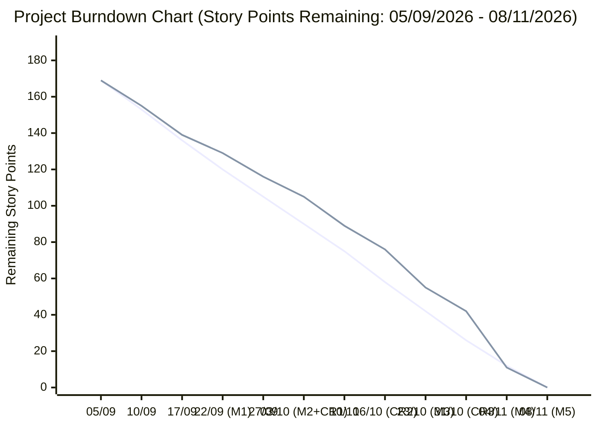
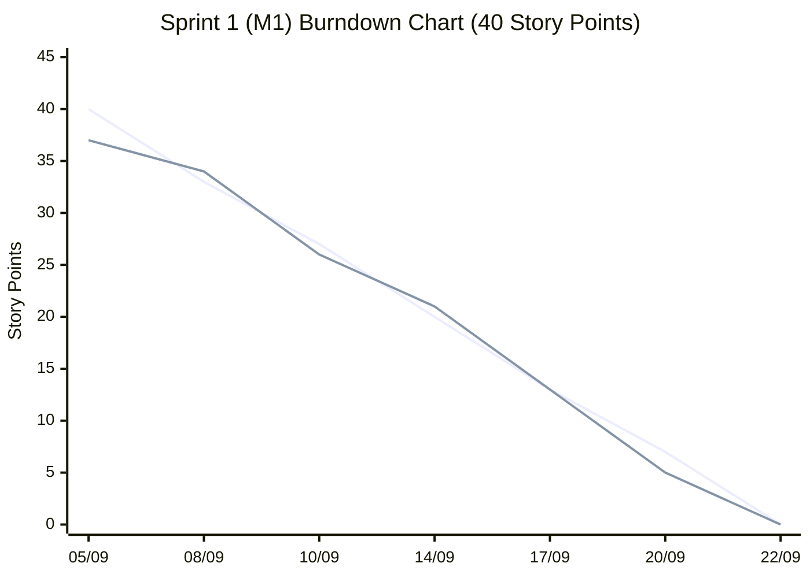
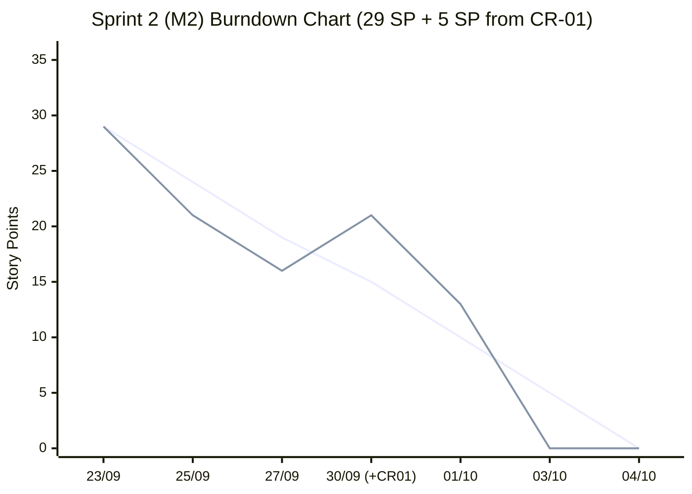
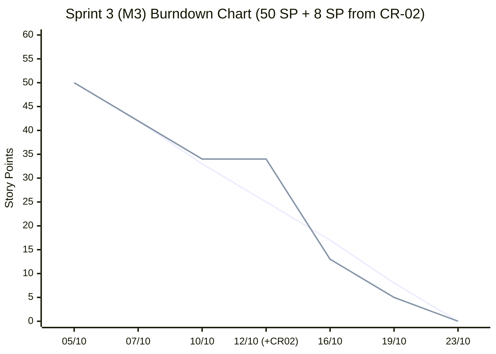
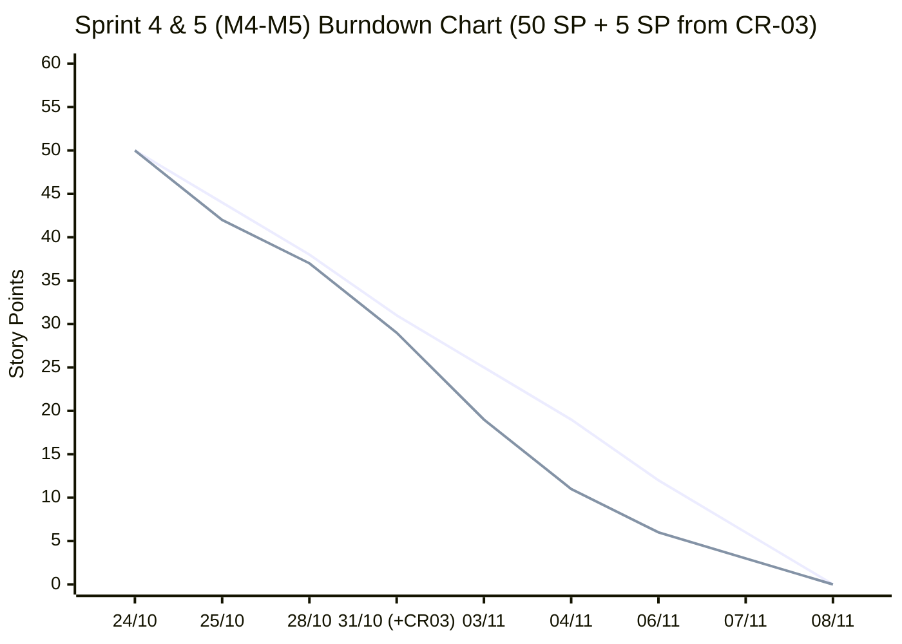
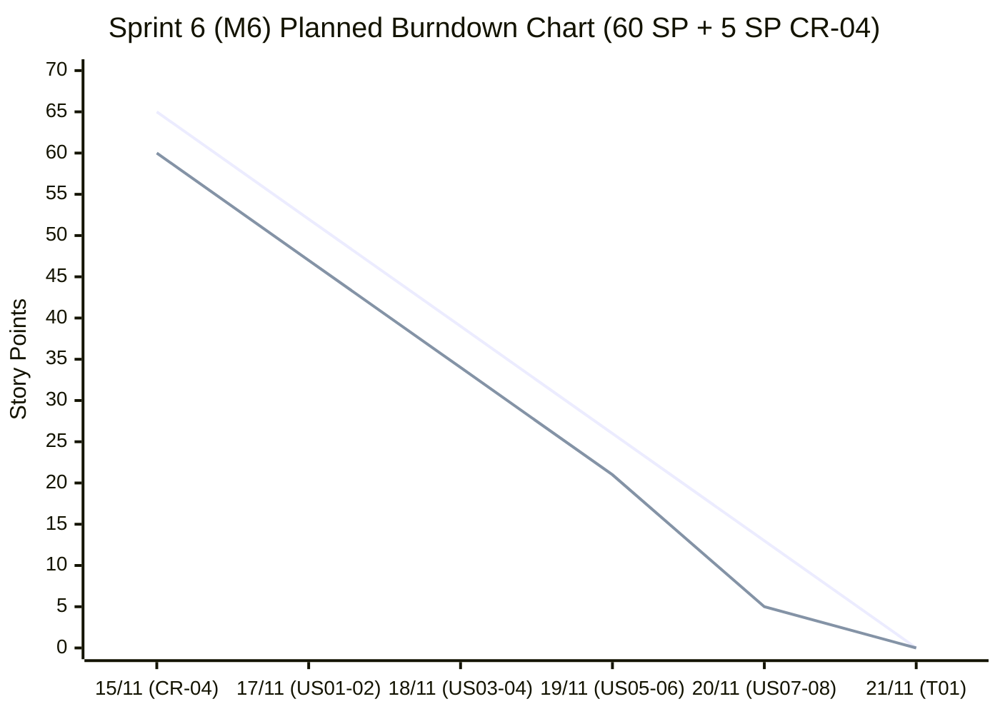

# 📉 BÁO CÁO BIỂU ĐỒ BURNDOWN & VẬN TỐC NHÓM (SPRINT BURNDOWN REPORT)

**Dự án:** `TOEIC_Trainer` (https://github.com/ADINEBAN/TOEIC)  
**Bảng GitHub Projects:** https://github.com/users/ADINEBAN/projects/4  
**Thời gian:** `05/09/2026` – `21/11/2026` (6 Sprints / Milestones `M1` ➔ `M6`)  
**Tổng khối lượng dự án (M1–M6):** **252 Story Points** (34 User Stories/Tasks + 4 Change Requests)

---

## 1. Tổng hợp Vận tốc Nhóm qua 6 Sprints (Sprint Velocity Summary)

| Sprint / Milestone | Thời gian | Số Issues (US/Task + CR) | Story Points Cam kết | Story Points Phát sinh (CR) | Story Points Hoàn thành / Mục tiêu | Tỷ lệ / Trạng thái |
| :--- | :---: | :---: | :---: | :---: | :---: | :---: |
| **Sprint 1 (`M1`)** | `05/09` – `22/09/2026` | 7 Issues (`#50, #44, #45, #52, #53, #54, #69`) | 40 SP | 0 SP | **40 SP** | **100%** (Done) |
| **Sprint 2 (`M2`)** | `23/09` – `04/10/2026` | 4 Issues + `CR-01` (`#56, #57, #63, #62, #72`) | 29 SP | +5 SP (`CR-01`) | **34 SP** | **100%** (Done) |
| **Sprint 3 (`M3`)** | `05/10` – `23/10/2026` | 6 Issues + `CR-02` (`#61, #60, #51, #49, #59, #58, #73`) | 50 SP | +8 SP (`CR-02`) | **58 SP** | **100%** (Done) |
| **Sprint 4 (`M4`)** | `24/10` – `05/11/2026` | 5 Issues + `CR-03` (`#64, #68, #66, #65, #55, #74`) | 39 SP | +5 SP (`CR-03`) | **44 SP** | **100%** (Done) |
| **Sprint 5 (`M5`)** | `06/11` – `08/11/2026` | 3 Issues (`#67, #70, #71`) | 11 SP | 0 SP | **11 SP** | **100%** (Done) |
| **Sprint 6 (`M6`)** | `15/11` – `21/11/2026` | 9 Issues + `CR-04` (`#80, #82..#90`) | 60 SP | +5 SP (`CR-04`) | **65 SP (Plan)** | 🔄 **Active Sprint** (`CR-04` Done; `#82..#90` UAT/Merge `17–21/11`) |
| **Toàn dự án** | **`05/09` – `21/11/2026`** | **34 US/Tasks + 4 CRs (kèm 11 Epics)** | **229 SP** | **+23 SP** | **192 SP Done / 252 SP** | 🔄 **76% Done (M1–M5 + CR-04)** |

---

## 2. Biểu Đồ Burndown Tổng Thể Toàn Dự Án (`05/09/2026` ➔ `08/11/2026`)

---

## 3. Biểu Đồ Burndown Chi Tiết Từng Sprint

### 🔹 Sprint 1 (`M1`: `05/09/2026` – `22/09/2026`) — Foundation, Auth & Core Setup (40 SP)

### 🔹 Sprint 2 (`M2`: `23/09/2026` – `04/10/2026`) — Vocabulary, Grammar & Video CDN (+`CR-01`) (34 SP)

### 🔹 Sprint 3 (`M3`: `05/10/2026` – `23/10/2026`) — Question Bank, Practice & Learning Path (+`CR-02`) (58 SP)

### 🔹 Sprint 4 & 5 (`M4`–`M5`: `24/10/2026` – `08/11/2026`) — Admin Portal, Mock Exam, AI Explain (+`CR-03`) & Handover (55 SP)

### 🔹 Sprint 6 (`M6`: `15/11/2026` – `21/11/2026`) — Production Docker Deploy (`CR-04`) & v1.1 Feature Enhancements (65 SP)

